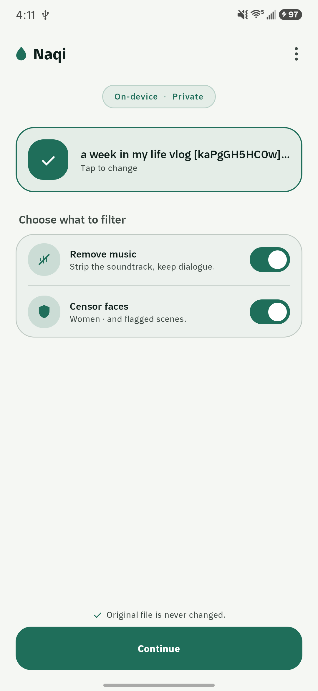
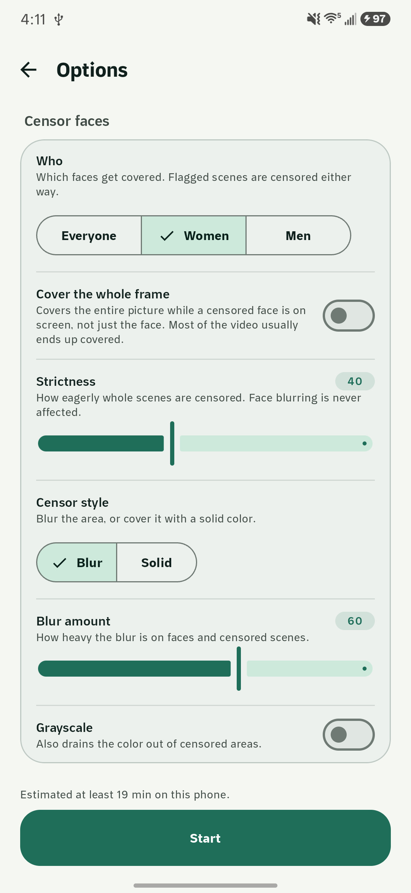
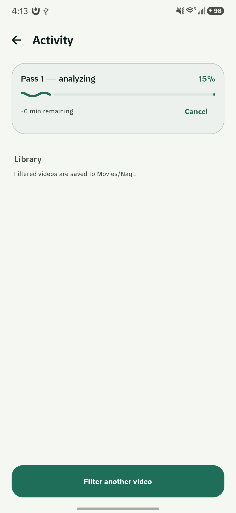
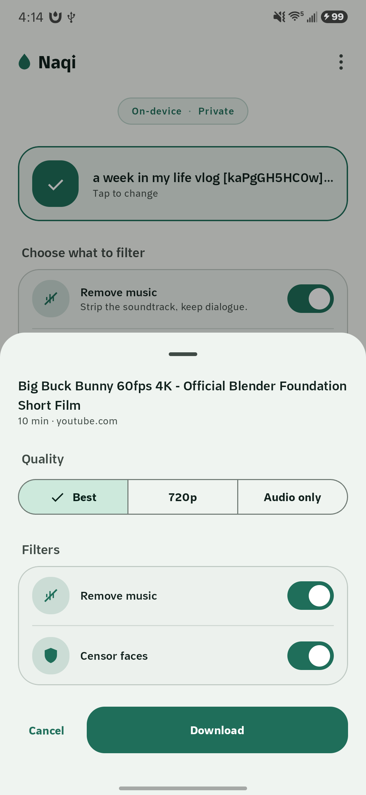
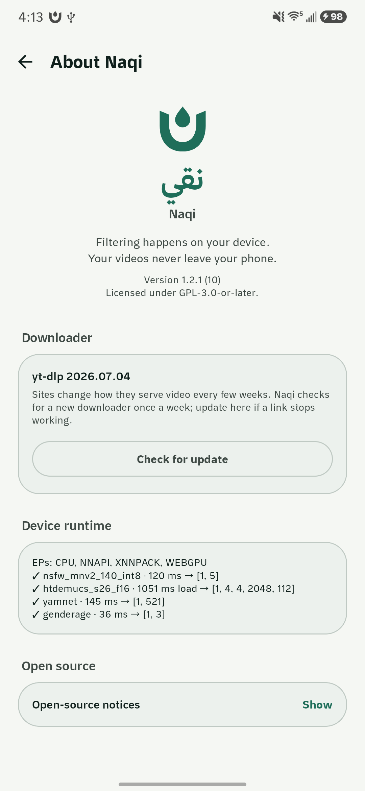

<p align="center">
  
</p>

<h1 align="center">نقي — فلتر الفيديو الحلال</h1>

<p align="center">
  تطبيقات لأندرويد وآيفون وآيباد وماك تفلتر الفيديو <b>على جهازك</b>: تزيل الموسيقى من الصوت وتحجب الوجوه أو الأجسام في الصورة.<br>
  بلا حسابات، بلا تتبّع. والملف الأصلي لا يُمَسّ.
</p>

<p align="center">
  <a href="https://github.com/haithamassoli/NaqiHalalVideoFilter/releases"></a>
  <a href="https://apps.apple.com/app/id6798173054"></a>
  <a href="LICENSE"></a>
  <a href="apps/apple/LICENSE"></a>
</p>

<p align="center">
  <a href="README.md">English</a> · <b>العربية</b>
</p>

<p align="center">
  
  
  
  
  
</p>

<div dir="rtl">

**نَقيّ** تعني الطاهر الخالص.

## المنصّات

| المنصّة | من أين تحصل عليه | المتطلبات | المصدر |
| --- | --- | --- | --- |
| أندرويد | ملف APK من [إصدارات GitHub](https://github.com/haithamassoli/NaqiHalalVideoFilter/releases) (النسخة الكاملة)، ومتوفر أيضًا على [Google Play](https://play.google.com/store/apps/details?id=com.haithamassoli.naqi) | أندرويد 10 (API 29) فأحدث، ومعمارية arm64-v8a | [`apps/android`](apps/android) |
| آيفون وآيباد | [App Store](https://apps.apple.com/app/id6798173054) (مجانًا) | iOS / iPadOS 18 فأحدث | [`apps/apple`](apps/apple) |
| ماك | يُبنى من المصدر حاليًا، ونسخة موقّعة للتنزيل مخطط لها | macOS 15 فأحدث | [`apps/apple`](apps/apple) |
| ويندوز | تجريبي قيد التطوير: يُبنى من المصدر، أو خذ ملف MSI أو الملف المضغوط المحمول غير الموقّعَين من مخرجات [سير عمل ويندوز](.github/workflows/windows.yml) | ويندوز 10 أو 11، x64 | [`apps/windows`](apps/windows) |
| الويب | قيد التطوير وغير منشور: يُشغَّل من المصدر، ويرشّح الفيديو داخل المتصفح دون رفع أي شيء | كروم أو إيدج على الحاسوب | [`apps/web`](apps/web) |

نسخة APK على GitHub هي النسخة الكاملة لأندرويد. التنزيل بالرابط، والمشاركة إلى نقي، والمُحدِّث
الذاتي تأتي فيها وحدها، لأن سياسات Google Play لا تسمح بها. أما الفلترة نفسها فهي واحدة في
الحالتين. السبب مشروح في [`apps/android/README.ar.md`](apps/android/README.ar.md).

## ماذا يفعل

عمليتان مستقلتان، تعملان منفردتين أو معًا:

- **إزالة الموسيقى** — نموذج htdemucs يفصل الصوت إلى مسارات ويُبقي ما تختاره أنت
  (`الأصوات` فقط، أو `الأصوات + المؤثرات` للاحتفاظ بالمؤثرات الصوتية مقابل تسرّب بعض الموسيقى).
  الطبول والباس لا يُبقيان أبدًا. ويتحقق نموذج YAMNet أولًا من وجود موسيقى، فتُتخطّى المقاطع
  الخالية منها.
- **حجب الأشخاص** — يكتشف التطبيق الوجوه ويتتبّعها (ML Kit على أندرويد، وApple Vision على آيفون
  وآيباد وماك، وYuNet على ويندوز)، ثم يصوّت نموذج `genderage` من InsightFace على كل مسار وجه اعتمادًا على 5 لقطات
  أمامية كحدّ أقصى. وأنت تختار **من** يُحجب: الجميع، أو النساء، أو الرجال. ويُحجب المسار على
  امتداده كاملًا، لا إطارًا بإطار.

التغطية: **الوجه / الجسم / الجسم بدقة**، ويضيف أندرويد خيار **الشاشة**. ويقدّم ويندوز حاليًا الوجه والشاشة فقط. الوجه هو الافتراضي. خيارا
الجسم يضيفان YOLO11n-seg بمعدل 10 إطارات في الثانية فتصبح الفلترة أبطأ: «الجسم» يحجب مستطيلًا حول
الشخص وقد يشمل أجزاء من الخلفية، و«الجسم بدقة» يحجب حدود الشخص ويُبقي الخلفية ظاهرة.

وبمعزل عن الأشخاص، توجد **بوّابة المشاهد المخلّة** الاختيارية: تغطي الإطار كاملًا طوال اشتغالها،
مع تمهيد زمني قبل بدايته حتى لا يفلت الإطار الأول.

القابل للضبط: من يُحجب، شدّة التمويه، تعبئة لونية صلبة بدل التمويه (5 ألوان)، التدرّج الرمادي،
وضع تغطية الإطار كاملًا، وتشغيل بوّابة المشاهد المخلّة أو إيقافها مع درجة صرامتها (0–100).

ويشمل أيضًا:

- **التنزيل بالرابط** — الصق رابط فيديو أو شاركه، فيجلبه نقي ثم يفلتره. تختار الجودة
  (الأفضل / 1080p / 720p / 480p / صوت فقط). ينزل الملف في مجلد حجر صحي ولا يُنشر إلا بعد اكتماله.
- **المشاركة إلى نقي** — أرسل فيديو إلى نقي من قائمة المشاركة في أي تطبيق.
- **الملفات الصوتية أيضًا** — إزالة الموسيقى تعمل على الصوت دون فيديو.
- **الفيديوهات الطويلة** — يُحفظ التقدّم أولًا بأول، فتكمل المهمة المنقطعة من حيث توقفت.
- **العربية والإنجليزية**، مع تخطيط كامل من اليمين إلى اليسار بالعربية.

الصيغ المدعومة تختلف بين المنصّات: أندرويد يقرأ MP4 وMKV وWebM وMP3 وM4A؛ وتطبيق Apple يقرأ ما
تقرؤه مفككات Apple (MP4 وMOV وM4V وغيرها) إضافة إلى WebM، لكن لا يقرأ MKV. التفاصيل في ملف README
الخاص بكل تطبيق.

## الخصوصية

الفلترة تجري على جهازك. لا توجد أي حزمة تحليلات، ولا تتبّع، ولا يلزم حساب. وتستخدم التطبيقات
الإنترنت من أجل:

- جلب الوسائط من رابط تعطيه أنت، وتحديث أداة التنزيل (yt-dlp)؛
- على أندرويد: تنزيل النماذج الاختياري لمرة واحدة، والفحص اليومي لوجود إصدار جديد من التطبيق؛
- في النسخ المهيّأة بخادم نقي، **الفيديوهات التي مدتها 10 دقائق فأكثر**: من أجل إزالة الموسيقى أو
  تغطية الجسم يُرسَل مسار الصوت أو الفيديو إلى الخادم الموجود في [`server/`](server)، فيعالجه ثم
  يحذفه. هذا الخيار مفعّل افتراضيًا ويمكن إيقافه من داخل التطبيق (الخيارات على أندرويد، والإعدادات
  على Apple). وإن تعذّر الوصول إلى الخادم، يقوم الجهاز بالعمل بنفسه. أما الفيديوهات الأقصر فلا
  تغادر جهازك، وحجب الوجوه يجري عليه دائمًا.

## عن الدقة، بصراحة

النماذج جيدة لا كاملة. الوجه الذي لم يُرَ أماميًا قط قد يبقى غير محسوم، ويخطئ تصويت الجنس مع
الوجوه الجزئية والأطفال والأشياء التي يعدّها كاشف الوجوه وجوهًا. والصرامة العالية تُفرِط في الحجب
عن قصد — وهذا هو الاتجاه الآمن، وهو السلوك المقصود لا خللًا. وإزالة الموسيقى تُبقي الغناء مع الحوار،
لأن مُفرِّق المسارات لا يفرّق بينهما. راجع النتيجة قبل مشاركتها.

وإن أردت أشدّ نتيجة ممكنة، فاختر **الجميع** بدل تحديد جنس، وفعّل وضع تغطية الإطار كاملًا.

## بنية المستودع

</div>

```
apps/android/   Android app (Kotlin, Gradle) with its scripts and design docs
apps/apple/     iPhone, iPad and Mac app (Swift, Xcode), imported with its history
apps/windows/   Windows app (Kotlin, Compose Desktop; beta, in development)
apps/web/       Naqi Web: filters in the browser, no backend (TypeScript, Vite; in development)
core/           pure-Kotlin logic shared by the Android and Windows apps (EDL, DSP, gates)
models/         model export, conversion and quantization scripts, and model benchmarks
server/         optional server for long videos (Modal)
web/            the website (Astro; Vercel builds from this directory)
branding/       icon, logo and store artwork, and the script that generates them
docs/           cross-platform docs: model benchmarks and screenshots
```

<div dir="rtl">

## البناء

الخطوات الكاملة في ملف README الخاص بكل تطبيق.

- **أندرويد** — جهّز أداة تصدير نموذج الجسم، ثم نفّذ
  `cd apps/android && ./scripts/fetch-models.sh && ./gradlew assembleDebug`.
  انظر [`apps/android/README.ar.md`](apps/android/README.ar.md).
- **آيفون وآيباد وماك** — جهّز نماذج أندرويد أولًا، ثم نفّذ `cd apps/apple && ./scripts/fetch-models.sh`
  وافتح `naqi.xcodeproj` في Xcode. الخطوط ونموذج الأشخاص بصيغة Core ML يحتاجان خطوات إضافية. انظر
  [`apps/apple/README.ar.md`](apps/apple/README.ar.md).
- **ويندوز** — بوجود JDK 21، نفّذ `cd apps/windows && ./gradlew :app:stageModels :app:run`. ويُبنى
  ويعمل على macOS أيضًا. انظر [`apps/windows/README.ar.md`](apps/windows/README.ar.md).
- **تطبيق الويب** — جهّز نماذج أندرويد وويندوز أولًا، ثم نفّذ `cd apps/web && pnpm install &&
  ./scripts/fetch-models.sh && ./scripts/build-spleeter.sh && pnpm dev`. انظر
  [`apps/web/README.ar.md`](apps/web/README.ar.md).
- **الموقع** — `cd web && pnpm install && pnpm dev`. انظر [`web/README.md`](web/README.md).

## الإصدارات

لكل تطبيق إصداراته ووسومه الخاصة. يبقى أندرويد على وسوم `vX.Y.Z` المعتادة، فهي التي يقرؤها المُحدِّث
داخل التطبيق والموقع. ويستخدم تطبيقا Apple وويندوز وسوم `apple-vX.Y.Z` و`windows-vX.Y.Z`. قواعد الإصدار في
[`docs/RELEASING.md`](docs/RELEASING.md).

## المساهمة

المسائل وطلبات الدمج مرحّب بها — ابدأ من [`CONTRIBUTING.md`](CONTRIBUTING.md). وبلاغات الأمان في
[`SECURITY.md`](SECURITY.md).

## الرخصة

تختلف الرخصة باختلاف المجلد:

| المسار | الرخصة |
| --- | --- |
| كل شيء عدا المجلدات التي فيها ملف `LICENSE` خاص بها (حاليًا `apps/apple/` وحده) | **GPL-3.0-or-later** — انظر [`LICENSE`](LICENSE) و[`NOTICE`](NOTICE). تطبيق أندرويد يرتبط بمكتبة youtubedl-android (برخصة GPL-3.0)، وهي التي تحدّد الرخصة. |
| `apps/apple/` | **Naqi Personal Non-Commercial License** (رخصة الاستخدام الشخصي غير التجاري) — انظر [`apps/apple/LICENSE`](apps/apple/LICENSE) و[`apps/apple/NOTICE`](apps/apple/NOTICE). وهي تحلّ محلّ رخصة الجذر في ذلك المجلد. |

النماذج والخطوط وشيفرات الأطراف الثالثة المشحونة تبقى على شروطها الخاصة، الموضّحة في ملف `NOTICE`
لكل منها. ونموذج واحد مستخدم على أندرويد ما تزال شروطه **غير محسومة**: اقرأ [`NOTICE`](NOTICE) قبل
إعادة توزيع تطبيق أندرويد أو نشره في أي متجر.

</div>
