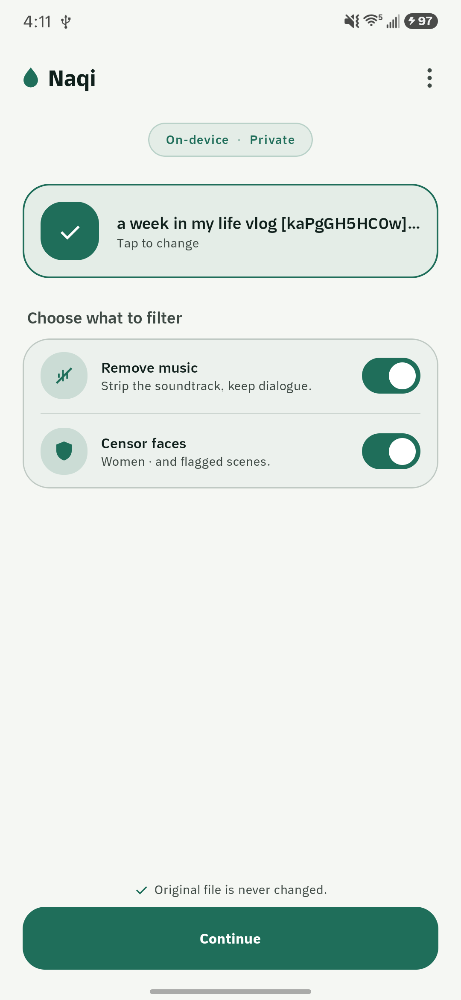
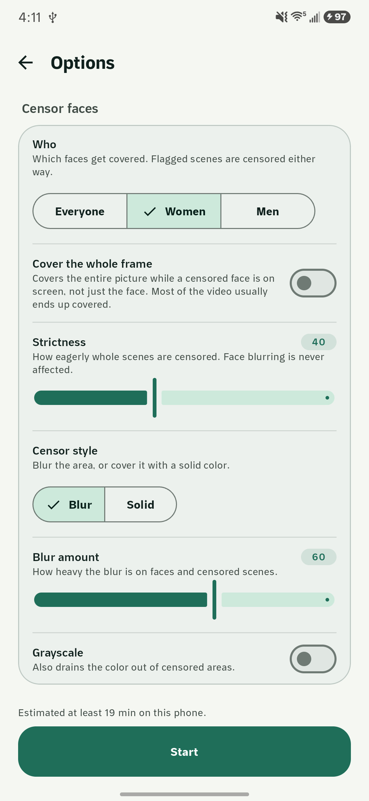
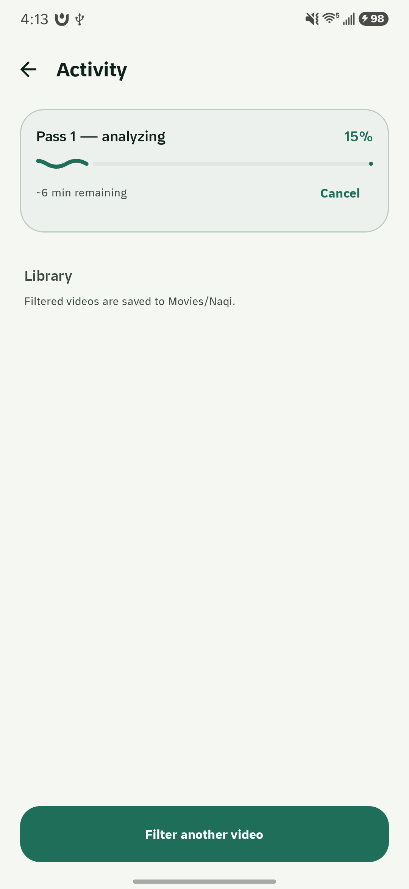
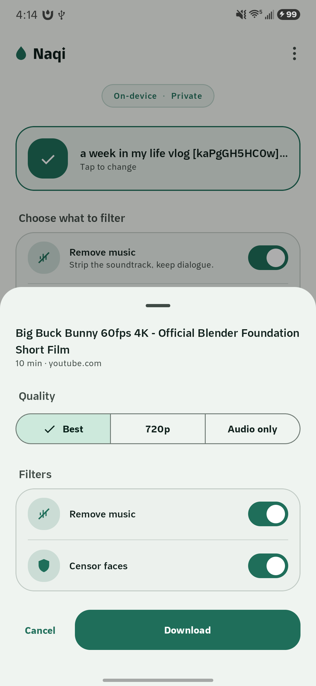
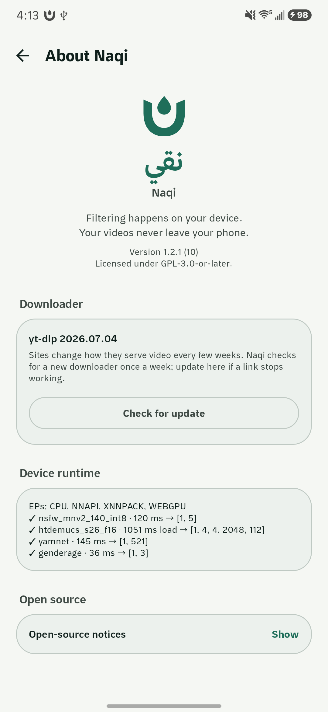

<p align="center">
  
</p>

<h1 align="center">Naqi — Halal Video Filter</h1>

<p align="center">
  Apps for Android, iPhone, iPad and Mac that filter video <b>on the device</b>: they remove music
  from the audio and censor faces or bodies in the picture.<br>
  No accounts, no telemetry. The original file is never modified.
</p>

<p align="center">
  <a href="https://github.com/haithamassoli/NaqiHalalVideoFilter/releases"></a>
  <a href="https://apps.apple.com/app/id6798173054"></a>
  <a href="LICENSE"></a>
  <a href="apps/apple/LICENSE"></a>
</p>

<p align="center">
  <b>English</b> · <a href="README.ar.md">العربية</a>
</p>

*Naqi (نقي) means "pure" in Arabic.*

<p align="center">
  
  
  
  
  
</p>

## Platforms

| Platform | Get it | Requires | Source |
| --- | --- | --- | --- |
| Android | APK on [GitHub Releases](https://github.com/haithamassoli/NaqiHalalVideoFilter/releases) (full build); also on [Google Play](https://play.google.com/store/apps/details?id=com.haithamassoli.naqi) | Android 10 (API 29) or newer, arm64-v8a | [`apps/android`](apps/android) |
| iPhone and iPad | [App Store](https://apps.apple.com/app/id6798173054) (free) | iOS / iPadOS 18 or newer | [`apps/apple`](apps/apple) |
| Mac | Build from source for now; a signed download is planned | macOS 15 or newer | [`apps/apple`](apps/apple) |
| Windows | Beta, in development: build from source, or the unsigned MSI or portable zip from the [Windows workflow](.github/workflows/windows.yml)'s artifacts | Windows 10 or 11, x64 | [`apps/windows`](apps/windows) |

The Android APK on GitHub is the full build. Download by link, sharing into Naqi and the in-app
updater ship only there, because Google Play's policies do not allow them. The filtering is the same
in both. [`apps/android/README.md`](apps/android/README.md) explains why.

## What it does

Two independent operations, run alone or together:

- **Remove music** — htdemucs stem separation splits the audio and keeps only the stems you choose
  (`vocals`, or `vocals + other` to retain sound effects at the cost of some music leakage).
  Drums and bass are never kept. A YAMNet gate checks for music first, so music-free stretches skip
  separation.
- **Censor people** — the app finds and tracks faces (ML Kit on Android, Apple Vision on iPhone, iPad
  and Mac, YuNet on Windows), and an InsightFace `genderage` vote resolves each track from up to 5 frontal crops. You
  pick **who** gets covered: everyone, women, or men. A track is censored for its whole span, not
  frame by frame.

Coverage can be **Face / Body / Precise body**, and Android also offers **Frame**. Windows offers
Face and Frame for now. Face is the
default. Both body options add YOLO11n-seg at 10 fps and are slower: Body covers a rectangle around
the person, which can also blur background; Precise body covers the person's outline and keeps the
background visible.

Independently of people, an optional **NSFW scene gate** covers the entire frame while it fires, with
pre-roll so nothing slips through on the first frame.

Adjustable: who gets censored, blur amount, a solid fill instead of blur (5 colours), grayscale,
whole-frame mode, and the scene gate's on/off plus strictness (0–100).

Also included:

- **Download by link** — paste or share a video URL and Naqi fetches it, then filters it. Pick the
  quality (best / 1080p / 720p / 480p / audio-only). The download lands in a quarantine directory
  and is only published once complete.
- **Share into Naqi** — send a video to Naqi from another app's share sheet.
- **Audio files too** — music removal works on audio without any video.
- **Long videos** — progress is checkpointed, so an interrupted job picks up where it stopped.
- **English and Arabic**, with a full right-to-left layout in Arabic.

Input formats differ by platform: Android reads MP4, MKV, WebM, MP3 and M4A; the Apple app reads
what Apple's decoders read (MP4, MOV, M4V and more) plus WebM, but not MKV. Each app's README has the
details.

## Privacy

Filtering runs on the device. There are no analytics SDKs, no tracking, and no account. The apps use
the network for:

- fetching media from a link you give them, and keeping the link downloader (yt-dlp) up to date;
- on Android, the optional one-time model download and the daily check for a new app version;
- in builds configured with Naqi's server, **videos of 10 minutes or more**: for music removal or
  body coverage, the audio track or the video is sent to the server in [`server/`](server), which
  processes it and then deletes it. This is on by default and can be turned off in the app (Options
  on Android, Settings on Apple). If the server is unavailable, the device does the work. Shorter
  videos never leave the device, and face censoring always runs on it.

## Accuracy, honestly

The models are good, not perfect. A face never seen frontally may go unresolved, and the gender vote
makes mistakes on partial faces, children and non-faces that the detector reports as faces. High
strictness deliberately over-censors — that is the safe direction, and it is the intended behaviour,
not a bug. Music removal keeps singing along with dialogue, because to a stem separator they are the
same thing. Review the result before sharing it.

If you want the strictest possible result, pick **everyone** rather than a gender, and turn the
whole-frame mode on.

## Repository layout

```
apps/android/   Android app (Kotlin, Gradle) with its scripts and design docs
apps/apple/     iPhone, iPad and Mac app (Swift, Xcode), imported with its history
apps/windows/   Windows app (Kotlin, Compose Desktop; beta, in development)
core/           pure-Kotlin logic shared by the Android and Windows apps (EDL, DSP, gates)
models/         model export, conversion and quantization scripts, and model benchmarks
server/         optional server for long videos (Modal)
web/            the website (Astro; Vercel builds from this directory)
branding/       icon, logo and store artwork, and the script that generates them
docs/           cross-platform docs: model benchmarks and screenshots
```

## Building

Each app's README has the full steps.

- **Android** — set up the body-model exporter, then `cd apps/android && ./scripts/fetch-models.sh
  && ./gradlew assembleDebug`. See [`apps/android/README.md`](apps/android/README.md).
- **iPhone, iPad and Mac** — fetch the Android models first, then `cd apps/apple &&
  ./scripts/fetch-models.sh` and open `naqi.xcodeproj` in Xcode. Fonts and the Core ML person model
  need extra steps. See [`apps/apple/README.md`](apps/apple/README.md).
- **Windows** — JDK 21, then `cd apps/windows && ./gradlew :app:stageModels :app:run`. It builds and
  runs on macOS too. See [`apps/windows/README.md`](apps/windows/README.md).
- **Website** — `cd web && pnpm install && pnpm dev`. See [`web/README.md`](web/README.md).

## Releases

Every app publishes its GitHub Releases in this repository, each with its own tags. Android keeps
plain `vX.Y.Z` tags, which the in-app updater and the website read. The Apple and Windows apps use
`apple-vX.Y.Z` and `windows-vX.Y.Z`. The rules are in [`docs/RELEASING.md`](docs/RELEASING.md).

## Contributing

Issues and pull requests are welcome — start with [`CONTRIBUTING.md`](CONTRIBUTING.md). Security
reports go to [`SECURITY.md`](SECURITY.md).

## Licence

Different directories carry different licences:

| Path | Licence |
| --- | --- |
| Everything except a directory with its own `LICENSE` (today only `apps/apple/`) | **GPL-3.0-or-later** — see [`LICENSE`](LICENSE) and [`NOTICE`](NOTICE). The Android app links youtubedl-android (GPL-3.0), which is what determines the licence. |
| `apps/apple/` | **Naqi Personal Non-Commercial License** — see [`apps/apple/LICENSE`](apps/apple/LICENSE) and [`apps/apple/NOTICE`](apps/apple/NOTICE). It overrides the root licence for that directory. |

Bundled models, fonts and third-party code keep their own terms, listed in each `NOTICE`. One model
used on Android has terms that are **not yet resolved**: read [`NOTICE`](NOTICE) before
redistributing the Android app or shipping it to an app store.
