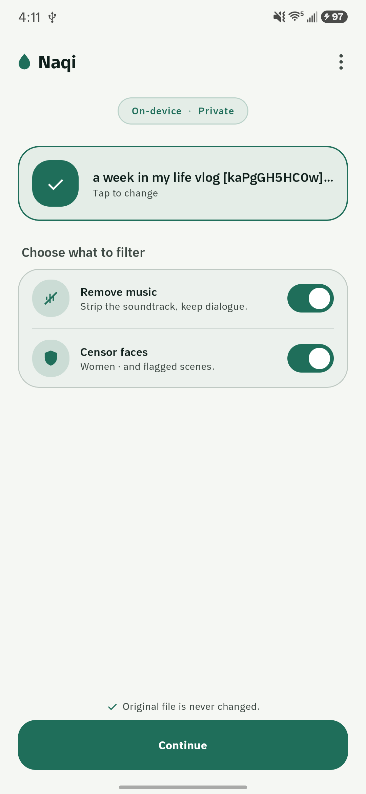
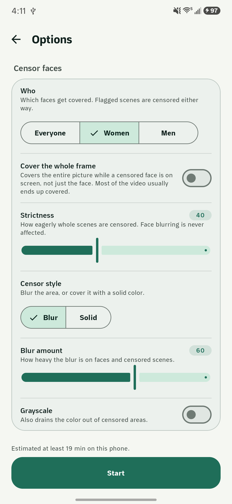
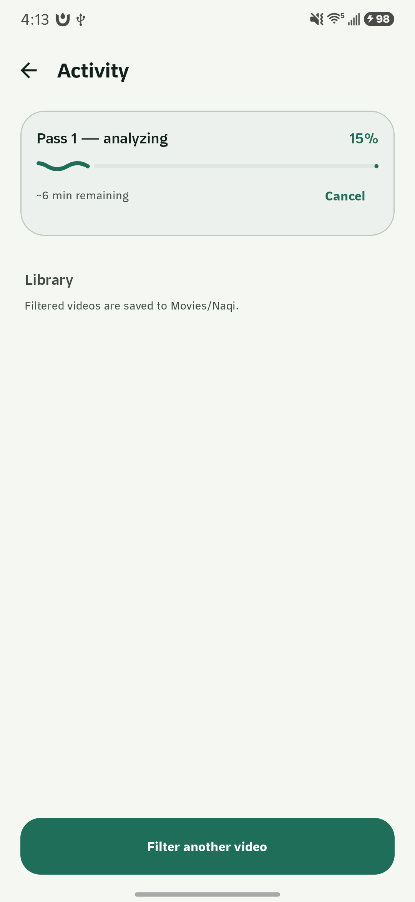
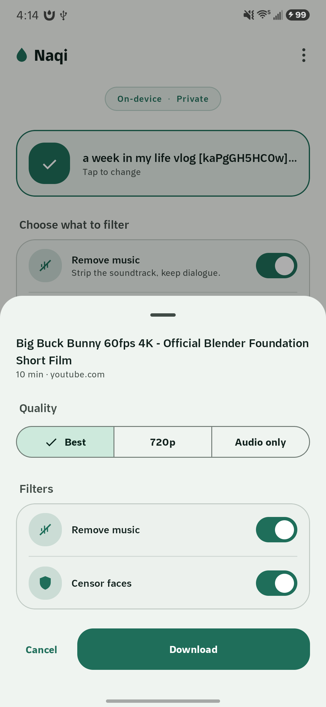
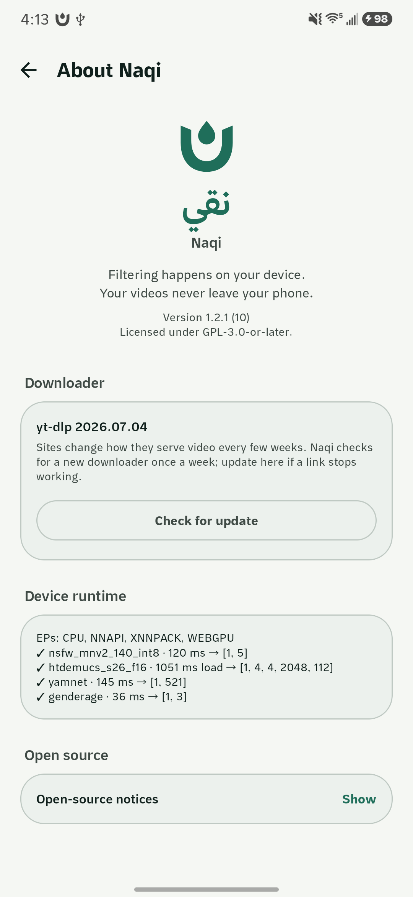

<p align="center">
  
</p>

<h1 align="center">نقي لأندرويد</h1>

<p align="center">
  تطبيق أندرويد يفلتر الفيديو <b>على جهازك</b>: يزيل الموسيقى من الصوت ويحجب الوجوه في الصورة. والملف الأصلي لا يُمَسّ.
</p>

<p align="center">
  <a href="https://github.com/haithamassoli/NaqiHalalVideoFilter/releases"></a>
  <a href="../../LICENSE"></a>
  
  
</p>

<p align="center">
  <a href="README.md">English</a> · <b>العربية</b>
</p>

<p align="center">
  
  
  
  
  
</p>

<div dir="rtl">

هذا تطبيق أندرويد ضمن مستودع نقي الموحّد. ما تفعله التطبيقات، وبيان الخصوصية، والمنصّات الأخرى
موضّحة في [ملف README الرئيسي](../../README.ar.md). وتطبيق آيفون وآيباد وماك موجود في
[`../apple`](../apple).

## على أندرويد

- **حجب الوجوه** — ML Kit يكتشف الوجوه ويتتبّعها عبر الفيديو، ثم يصوّت نموذج `genderage` من
  InsightFace على كل مسار وجه اعتمادًا على 5 لقطات أمامية كحدّ أقصى.
- **التغطية**: يمكن اختيار **الوجه / الجسم / الجسم بدقة / الشاشة**. الوجه هو الافتراضي. يضيف خيارا
  الجسم نموذج YOLO11n-seg بمعدل 10 إطارات في الثانية وينبّهان إلى أن الفلترة أبطأ: خيار الجسم يغطي
  مستطيلات الأشخاص وقد تشمل أجزاء من الخلفية، وخيار الجسم بدقة يغطي حدود كل شخص ويُبقي الخلفية واضحة.
- **التنزيل بالرابط** — شارك رابط فيديو أو الصقه، فيجلبه نقي عبر yt-dlp ثم يفلتره.
- **المشاركة إلى نقي** — شارك فيديو من أي تطبيق فيدخل الطابور فورًا وعليه الفلاتر التي استخدمتها
  آخر مرة. شارك عدة ملفات فتُعالَج بالترتيب.
- **الملفات الصوتية أيضًا** — MP3 و M4A تمرّ على إزالة الموسيقى وحدها، بلا حاجة إلى فيديو.
- **الأفلام الطويلة** — المدخل الطويل يُحفَظ نقطة تفتيش عند كل مقطع، وينجو من موت العملية ومن إعادة
  التشغيل ومن سقف الست ساعات لخدمة المقدّمة.
- **الإنجليزية والعربية**، مع اختيار لغة التطبيق منفردًا على أندرويد 13 فأحدث.

الصيغ المدعومة: MP4 · MKV · WebM · MP3 · M4A.

يطلب التطبيق إذن `INTERNET` من أجل: تنزيل النماذج الاختياري لمرة واحدة، وميزة التنزيل بالرابط التي
تستدعيها أنت صراحةً، والفحص اليومي لوجود إصدار جديد من التطبيق والأسبوعي لـ yt-dlp، وفي النسخ
المهيّأة بخادم، إرسال الفيديوهات التي مدتها 10 دقائق فأكثر إليه (انظر
[الخصوصية](../../README.ar.md#الخصوصية)).

## التثبيت

حمّل ملف APK من [صفحة الإصدارات](https://github.com/haithamassoli/NaqiHalalVideoFilter/releases).
وبعد التثبيت يتفقّد نقي GitHub بنفسه بحثًا عن إصدار أحدث ويعرض التحديث داخل التطبيق — والنسخة
المثبَّتة من إصدار تجريبي تبقى على القناة التجريبية.

**نسخة APK هنا هي النسخة الكاملة.** التنزيل بالرابط، والمشاركة إلى نقي، والمُحدِّث الذاتي تأتي في
هذه النسخة وحدها. ولا يمكن لنسخة متجر Play أن تحملها: yt-dlp يجلب شيفرة تنفيذية ويحدّثها أثناء
التشغيل، وهذا ما تمنعه سياسة Device and Network Abuse، كما يمنع Play تحديث التطبيق لنفسه أصلًا. أما
الفلترة نفسها فهي واحدة في الحالتين.

**المتطلبات:** أندرويد 10 (API 29) فأحدث، ومعمارية **arm64-v8a** فقط. ومساحة فارغة بنحو ضعف حجم
الفيديو. حجم الـ APK كبير لأن نماذج ONNX تُشحن بداخله.

## البناء من المصدر

النماذج مستثناة من git (نحو 115 ميغابايت من ONNX). أي نسخة جديدة تحتاج تبعيات تصدير نموذج الجسم
بالإصدارات المحددة، ثم تشغيل سكربت الجلب. البيئة الافتراضية لأداة التصدير تقع في جذر المستودع، حيث
تبحث عنها سكربتات [`models/`](../../models) المشتركة. من جذر المستودع:

</div>

```bash
python3 -m venv .venv-bench
.venv-bench/bin/pip install ultralytics==8.4.171 onnx==1.23.1 torch==2.14.0
apps/android/scripts/fetch-models.sh
```

<div dir="rtl">

يستعيد السكربت أربعة نماذج من ملف APK للإصدار 1.4.4، ويصدّر YOLO11n-seg محليًا عبر
`models/export_person.py`، ويتحقق من بصمات SHA-256 للنماذج الخمسة. يرفض البناء غياب أي نموذج حتى لا
ينتج تطبيق يبدو سليمًا بينما تتعطل الفلترة. خطوات إعادة توليد النماذج في
[`docs/m0-spikes.md`](docs/m0-spikes.md).

ثم من داخل `apps/android`:

</div>

```bash
./gradlew assembleDebug
./gradlew compileDebugKotlin testDebugUnitTest   # بوّابة البناء الخضراء
```

<div dir="rtl">

توقيع نسخة الإصدار يحتاج أربع خصائص Gradle — ضعها في `~/.gradle/gradle.properties`، لا في المستودع
أبدًا:

</div>

```properties
naqiStoreFile=/absolute/path/to/naqi.jks
naqiStorePassword=...
naqiKeyAlias=...
naqiKeyPassword=...
```

<div dir="rtl">

وبدونها يبقى `assembleRelease` قابلًا للبناء، لكن بلا توقيع.

الخادم الاختياري للفيديوهات الطويلة يُهيّأ بالخاصيتين `naqiCloudUrl` و`naqiCloudKey`، من
`local.properties` أو عبر `-P`، ولا تُرفعان إلى المستودع أبدًا. وبدونهما تجري الفلترة كلها على الجهاز.
أما الخادم نفسه فهو [`server/naqi_modal.py`](../../server/naqi_modal.py).

وسوم الإصدارات بصيغة `vX.Y.Z`، وخطوات الإصدار في [`docs/RELEASING.md`](../../docs/RELEASING.md).

## كيف يعمل

التحليل والإخراج مرحلتان منفصلتان، وهذا ليس تحسينًا للأداء: تصويت الأغلبية على الجنس يحتاج مسار
الوجه كاملًا قبل إخراج أول إطار منه، وتمهيد الحجب يحتاج خط زمن المشاهد المخلّة قبل المُرمِّز.

**المرحلة الأولى (فك ترميز فقط)** تعاين بوّابة المشاهد المخلّة بمعدل 5 إطارات/ثانية والوجوه بمعدل 10
إطارات/ثانية، وتحسم جنس كل مسار وجه من 5 لقطات أمامية كحدّ أقصى، ثم تُخرِج ملف EDL: فترات الحجب مع
مناطق الوجوه لكل إطار.

**المرحلة الثانية** تعيد تشغيل الـ EDL عبر مُظلِّل GL في Media3 Transformer — وتأثير الإطار الكامل
يغلب مناطق الوجوه — ثم تُرمّز بصيغة H.264. المهام التي تحجب فقط تمرّر الصوت كما هو؛ والمهام التي
تزيل الموسيقى فقط تعيد تجميع عيّنات الفيديو الأصلية بلا إعادة ترميز إطلاقًا.

يُفَكّ الصوت إلى 44.1 كيلوهرتز f32 استريو، ويعمل htdemucs على دفعات متداخلة، ويُجمع من كل دفعة ما
أُبقي من المسارات فور حسمه، فلا يحتاج فيلم من ساعتين إلى تجسيد أربعة مسارات كاملة في الذاكرة.

التفاصيل الأوسع في [`docs/prd-video-filter-android.md`](docs/prd-video-filter-android.md) و
[`docs/long-film-plan.md`](docs/long-film-plan.md)، وعمل الأداء موثّق في
[`docs/perf-plan-v5.md`](docs/perf-plan-v5.md) وما سبقه. وقياسات النماذج المشتركة بين التطبيقات في
[`docs/bench/`](../../docs/bench) و[`docs/model-benchmark-plan.md`](../../docs/model-benchmark-plan.md)
في جذر المستودع.

### النماذج

| النموذج | وظيفته | الحجم | الرخصة |
| --- | --- | --- | --- |
| [htdemucs](https://github.com/facebookresearch/demucs) (مقطع 2.6 ث، fp16) | فصل مسارات الموسيقى والأصوات | 84 م.ب | MIT |
| [YAMNet](https://github.com/tensorflow/models/tree/master/research/audioset/yamnet) | بوّابة «هل هنا موسيقى؟» قبل الفصل | 15 م.ب | Apache-2.0 |
| [nsfw_model](https://github.com/GantMan/nsfw_model) بنسخة MobileNetV2 1.4-224 INT8 | بوّابة المشاهد المخلّة | 4.9 م.ب | NOASSERTION — انظر [`NOTICE`](../../NOTICE) |
| [InsightFace](https://github.com/deepinsight/insightface) `genderage` (buffalo_l) | تصويت الجنس لكل مسار وجه | 1.3 م.ب | الشيفرة MIT، والأوزان لاستخدام بحثي — انظر [`NOTICE`](../../NOTICE) |
| ML Kit Face Detection | اكتشاف الوجوه وتتبّعها | — | مغلقة المصدر، ضمن خدمات Google Play |
| [YOLO11n-seg](https://docs.ultralytics.com/models/yolo11) (FP32، 640×640) | مستطيلات الأجسام وحدودها (اختياري) | 12 م.ب | AGPL-3.0 |

وكل ذلك يعمل على [ONNX Runtime](https://github.com/microsoft/onnxruntime) (رخصة MIT) على المعالج.

قيس تصويت الجنس عند نحو 92% دقة متوازنة على مجموعة داخلية صغيرة — فتوقّع أخطاء مع الوجوه الجزئية
والأطفال والأشياء التي يعدّها ML Kit وجوهًا.

## المساهمة

ابدأ من [`CONTRIBUTING.md`](../../CONTRIBUTING.md). بوّابة البناء هي
`./gradlew compileDebugKotlin testDebugUnitTest`؛ أما `lintDebug` فيُخرج حاليًا أخطاءً سابقة وليس
بوّابة.

## الرخصة

**GPL-3.0-or-later.** انظر [`LICENSE`](../../LICENSE). نقي يرتبط بمكتبة youtubedl-android (برخصة
GPL-3.0)، وهي التي تحدّد رخصة المشروع كله.

⚠️ نموذج واحد مشحون داخل التطبيق ما تزال شروطه **غير محسومة**: أوزان بوّابة المشاهد المخلّة مُعلَّمة
NOASSERTION في مصدرها. التفاصيل والمسوّغات في [`NOTICE`](../../NOTICE) — اقرأه قبل إعادة توزيع هذا
التطبيق أو نشره في أي متجر. ونسبة الأطراف الثالثة كاملةً في الملف نفسه، ويعرضها التطبيق داخليًا في
«حول ← تراخيص المصادر المفتوحة».

</div>
