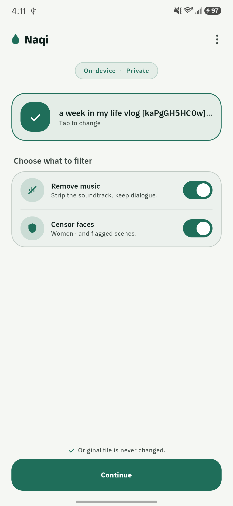
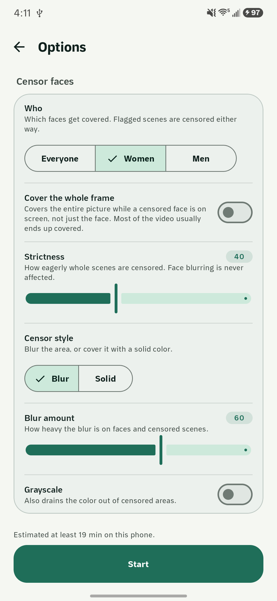
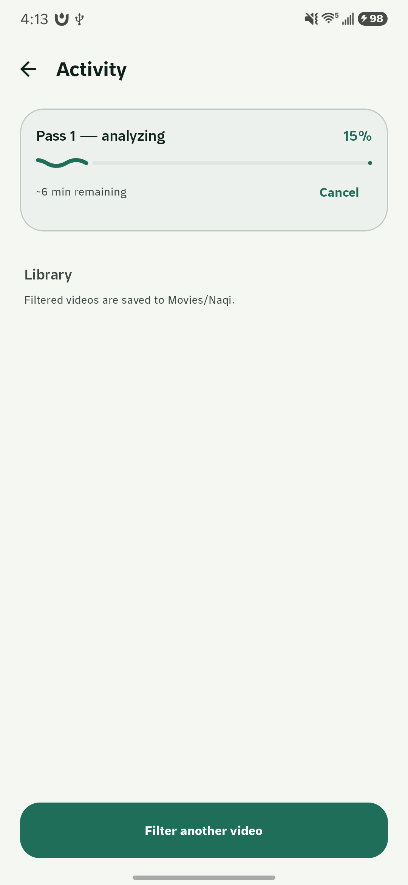
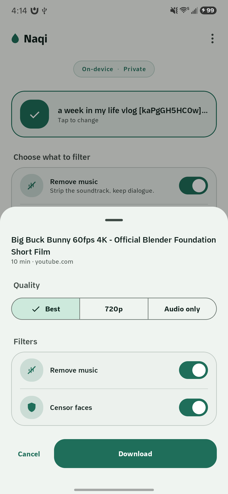
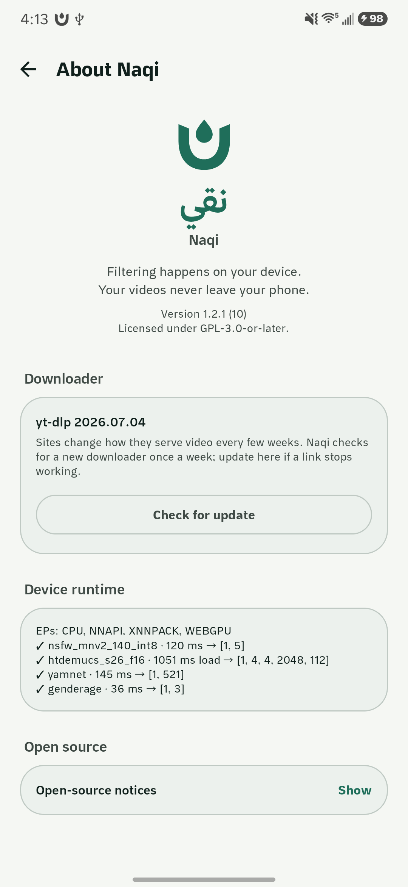

<p align="center">
  
</p>

<h1 align="center">Naqi for Android</h1>

<p align="center">
  Android app that filters video <b>on the device</b>: removes music from the audio and
  censors faces in the picture. The original file is never modified.
</p>

<p align="center">
  <a href="https://github.com/haithamassoli/NaqiHalalVideoFilter/releases"></a>
  <a href="../../LICENSE"></a>
  
  
</p>

<p align="center">
  <b>English</b> · <a href="README.ar.md">العربية</a>
</p>

<p align="center">
  
  
  
  
  
</p>

This is the Android app in the Naqi monorepo. What the apps do, the privacy statement and the other
platforms are in the [root README](../../README.md). The iPhone, iPad and Mac app is in
[`../apple`](../apple).

## On Android

- **Censor faces** — ML Kit finds and tracks faces across the video, and an InsightFace `genderage`
  vote resolves each track from up to 5 frontal crops.
- **Coverage** can be **Face / Body / Precise body / Frame**. Face is the default. Both body options
  add YOLO11n-seg at 10 fps and say that filtering is slower: Body covers person rectangles, which
  can also blur surrounding background; Precise body covers each person's outline and keeps the
  background clear.
- **Download by link** — share or paste a video URL and Naqi fetches it with yt-dlp, then filters
  it.
- **Share into Naqi** — share a video from any app and it queues straight away with the filters you
  used last time already selected. Share several and they run in order.
- **Audio files too** — MP3 and M4A go through music removal on their own, no video needed.
- **Long videos** — feature-length input checkpoints per segment and survives process death, a
  reboot, and the 6-hour foreground-service cap.
- **English and Arabic**, with per-app language selection on Android 13+.

Input formats: MP4 · MKV · WebM · MP3 · M4A.

The app requests `INTERNET` for the optional one-time model download, the link-download feature you
explicitly invoke, the daily check for a new app version and the weekly one for yt-dlp, and, in builds configured with
a server, sending videos of 10 minutes or more to it (see [Privacy](../../README.md#privacy)).

## Install

Grab the APK from [Releases](https://github.com/haithamassoli/NaqiHalalVideoFilter/releases). Once
installed, Naqi checks GitHub for newer releases itself and offers the update in-app — a build
installed from a pre-release stays on the pre-release channel.

**The APK here is the full build.** Download-by-link, share-into-Naqi and the in-app updater ship
only in this one. A Play Store build cannot carry them: yt-dlp fetches and updates executable code at
runtime, which Play's Device and Network Abuse policy does not allow, and Play bans self-updating
apps outright. The filtering itself is the same either way.

**Requirements:** Android 10 (API 29) or newer, **arm64-v8a** only. Free space of roughly
2× the video size. The APK is large because the ONNX models ship inside it.

## Build from source

The models are gitignored (~115 MB of ONNX). A fresh clone needs the pinned body-model exporter
dependencies, then the fetch script. The exporter's virtualenv lives at the repository root, where
the shared [`models/`](../../models) scripts look for it. From the repository root:

```bash
python3 -m venv .venv-bench
.venv-bench/bin/pip install ultralytics==8.4.171 onnx==1.23.1 torch==2.14.0
apps/android/scripts/fetch-models.sh
```

The script restores four models from the v1.4.4 APK, exports YOLO11n-seg locally with
`models/export_person.py`, and checks all five SHA-256 hashes. The build fails if any model is
missing, preventing an APK whose filtering cannot work. Model regeneration steps are in
[`docs/m0-spikes.md`](docs/m0-spikes.md).

Then, from `apps/android`:

```bash
./gradlew assembleDebug
./gradlew compileDebugKotlin testDebugUnitTest   # the green gate
```

Signing a release build needs four Gradle properties — put them in `~/.gradle/gradle.properties`,
never in the repo:

```properties
naqiStoreFile=/absolute/path/to/naqi.jks
naqiStorePassword=...
naqiKeyAlias=...
naqiKeyPassword=...
```

Without them `assembleRelease` still builds, just unsigned.

The optional server for long videos is configured with `naqiCloudUrl` and `naqiCloudKey`, from
`local.properties` or `-P`, never committed. Without them the build filters everything on the
device. The server itself is [`server/naqi_modal.py`](../../server/naqi_modal.py).

Releases are tagged `vX.Y.Z`; the process is in [`docs/RELEASING.md`](../../docs/RELEASING.md).

## How it works

Analysis and rendering are two separate passes, and that is not an optimization — majority-vote
gender needs the complete face track before its first frame can be rendered, and the censor
pre-roll needs the NSFW timeline ahead of the encoder.

**Pass 1 (decode only)** samples the NSFW gate at 5 fps and faces at 10 fps, resolves each face
track's gender from up to 5 frontal crops, and emits an EDL: censor intervals plus per-frame face
regions.

**Pass 2** replays the EDL through a Media3 Transformer GL shader — full-frame effect wins over
face regions — and encodes H.264. Censor-only jobs pass the audio through untouched; music-only
jobs remux the original video samples with no re-encode at all.

Audio decodes to 44.1 kHz f32 stereo, runs htdemucs in overlapping chunks, and sums only the kept
stems per chunk as they resolve, so a 2-hour film never materializes four full stems in memory.

More detail lives in [`docs/prd-video-filter-android.md`](docs/prd-video-filter-android.md) and
[`docs/long-film-plan.md`](docs/long-film-plan.md); the performance work is written up across
[`docs/perf-plan-v5.md`](docs/perf-plan-v5.md) and its predecessors. Model benchmarks shared with
the other apps are in the root [`docs/bench/`](../../docs/bench) and
[`docs/model-benchmark-plan.md`](../../docs/model-benchmark-plan.md).

### The models

| Model | Job | Size | Licence |
| --- | --- | --- | --- |
| [htdemucs](https://github.com/facebookresearch/demucs) (2.6 s segment, fp16) | music/vocal stem separation | 84 MB | MIT |
| [YAMNet](https://github.com/tensorflow/models/tree/master/research/audioset/yamnet) | "is there music here?" gate before separation | 15 MB | Apache-2.0 |
| [nsfw_model](https://github.com/GantMan/nsfw_model) MobileNetV2 1.4-224, INT8 | NSFW scene gate | 4.9 MB | NOASSERTION — see [`NOTICE`](../../NOTICE) |
| [InsightFace](https://github.com/deepinsight/insightface) `genderage` (buffalo_l) | per-face-track gender vote | 1.3 MB | code MIT, weights research-use — see [`NOTICE`](../../NOTICE) |
| ML Kit Face Detection | face detection and tracking | — | proprietary, Google Play services |
| [YOLO11n-seg](https://docs.ultralytics.com/models/yolo11) (FP32, 640×640) | optional body boxes and silhouettes | 12 MB | AGPL-3.0 |

Everything runs on [ONNX Runtime](https://github.com/microsoft/onnxruntime) (MIT) on the CPU.

The gender vote was measured at ~92% balanced accuracy on a small internal set — expect mistakes on
partial faces, children and non-faces that ML Kit reports as faces.

## Contributing

Start with [`CONTRIBUTING.md`](../../CONTRIBUTING.md). The build gate is
`./gradlew compileDebugKotlin testDebugUnitTest`; `lintDebug` currently reports pre-existing errors
and is not a gate.

## Licence

**GPL-3.0-or-later.** See [`LICENSE`](../../LICENSE). Naqi links youtubedl-android (GPL-3.0), which
is what determines the licence of the whole.

⚠️ One bundled model carries terms that are **not yet resolved**: the NSFW gate weights are
NOASSERTION upstream. The details and the reasoning are in [`NOTICE`](../../NOTICE) — read it before
redistributing this app or shipping it to an app store. Full third-party attribution is in the same
file, and the app surfaces it in-product under About → Open source licenses.
